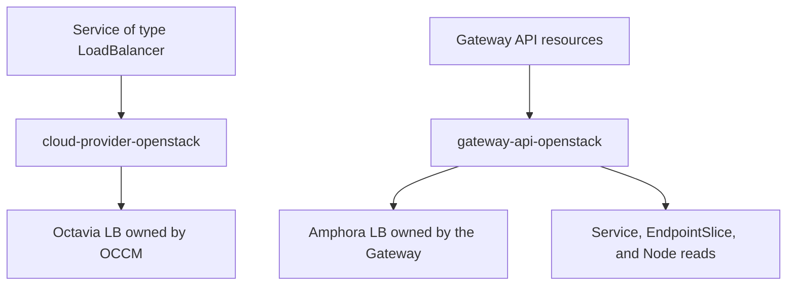

# Gateway API for OpenStack

> [!IMPORTANT]
> This project is pre-alpha and is not ready for production.
> No supported controller environment profile has been published.

This fork ports Gateway API for OpenStack to Kubernetes Gateway API v1.7.0 and adds an opt-in workload addon for clusters created by Magnum and magnum-capi-helm. The first traffic target is a private Amphora VIP forwarding HTTP to a worker NodePort. The [Hibiscus qualification record](docs/qualification/v1.7.0/README.md) covers all seven release profiles, the available evidence and the operator procedure.

The controller uses public OpenStack APIs. It keeps the upstream API group `gateway-api-openstack.github.io` and Go module path. [Personal Hibiscus fork](https://github.com/armeldemarsac92/gateway-api-openstack/tree/hibiscus/v1.7.0) · [Upstream project](https://github.com/gateway-api-openstack/gateway-api-openstack)

## How it works

One Gateway owns one Octavia load balancer and its listeners, pools, members, health monitors, and L7 resources.
The controller reads backend Services, EndpointSlices, and Nodes and manages only its own cloud resources.
The OpenStack Cloud Controller Manager (OCCM) continues to manage Services of type `LoadBalancer` and their cloud resources.

The controller does not adopt existing load balancers, manage tenant network topology, or replace OCCM.
It also does not migrate resources from cloud-provider-openstack's [Octavia Ingress Controller](https://github.com/kubernetes/cloud-provider-openstack/tree/master/docs/octavia-ingress-controller).
The [architecture](docs/design/architecture.md) defines ownership, resource mapping, reconciliation, and recovery.

## Current implementation

The controller uses Gateway API v1.7.0 and defaults to the Standard Channel. Its implemented routing scope includes:

- One active HTTP listener shared by multiple HTTPRoutes. The listener accepts its own namespace by default and can opt into all namespaces or a namespace label selector. An unsupported protocol on a separate port gets its own listener status.
- One rule, one match and one backend Service per HTTPRoute. Across routes the listener orders matching hostnames, Exact and PathPrefix paths, route age and names.
- HTTP/1.1 WebSocket Upgrade to a TCP Service port declaring `appProtocol: kubernetes.io/ws`. [Operator instructions](docs/getting-started.md) · [Qualification](docs/qualification/v1.7.0/provider/http-websocket.md)
- An optional exact or wildcard hostname on the listener and at most one on the HTTPRoute. Only the names shared by both reach the backend.
- One TCP listener on a dedicated Gateway. It forwards opaque streams to one Service port from the oldest attached TCPRoute. A newer attached route takes over when the older route detaches. [TCP example](docs/getting-started.md#forward-tcp-to-a-service)
- Distinct UDP ports on one dedicated Gateway share its VIP. Each listener selects its oldest eligible UDPRoute. A route that wins on several ports uses one shared pool. Endpoint mode supports weighted UDP Services with routable pod IPs. NodePort mode accepts a single Service. [UDP example](docs/getting-started.md#forward-udp-to-a-service)
- Eligible worker NodePort members with Local or Cluster traffic policy
- An opt-in IPv4 Endpoint mode for ClusterIP, headless, and NodePort Services, pending live network validation
- Typed GatewayClass configuration with topology settings fixed for each Gateway
- Automatic allocation for a single `IPAddress` request with no value. Gateway status reports the private VIP or, when the class enables one, the allocated Floating IP. Floating IP recovery also handles detachment.
- Referenced frontend and backend security groups without changing their rules
- Read-only environment diagnostics
- Ownership validation, restart recovery, and ordered cleanup

The [class configuration reference](docs/reference/class-configuration.md) describes member modes and their network prerequisites.
An HTTPRoute, TCPRoute or UDPRoute may select a Service in another namespace when a ReferenceGrant there authorizes that route kind and source namespace. Multiple active HTTP or TCP listeners, mixed protocols and HTTPS remain open. [Grant and revocation evidence](docs/qualification/v1.7.0/service-grants.md)
The stock pilot targets Amphora. Other Gateway profiles, the two mesh profiles and the Experimental resources are tracked in the [v1.7.0 feature matrix](docs/qualification/v1.7.0/matrix/README.md).

## Development status

Phase 4 connectivity features are implemented, with live validation and Core design work remaining.
Phase 5 includes the logical HTTP model, shared backend input collection, reference watches, and local Endpoint mode implementation.
See the [compatibility record](docs/providers/compatibility.md) for completed checks and outstanding evidence.
Development results do not establish general OpenStack support or Gateway API conformance.

The [upstream roadmap](ROADMAP.md) targets complete GATEWAY-HTTP Core support and all declared Extended features. The [Hibiscus plan](docs/superpowers/plans/2026-11-20-hibiscus.md) extends the target to the full v1.7.0 release.
It allows feature implementation and traffic validation to proceed alongside Octavia development after the corresponding design is accepted.
The [feasibility assessment](docs/design/conformance-feasibility.md) records the API blockers for individual features.
The [conformance guide](docs/testing-conformance.md) describes the required suite and reporting workflow.

## Getting started

The repository includes Kustomize manifests and a NodePort example for development.
Installation requires an operator-built controller image and a Secret containing OpenStack credentials.
Follow [Getting started](docs/getting-started.md) to install, verify, and remove the controller.
Use the [OpenStack E2E guide](docs/testing-openstack-e2e.md) for reusable traffic, recovery, and cleanup tests.

If finalization stops, keep the controller and its credentials available and follow [operator recovery](docs/operator-recovery.md).
Do not remove finalizers to bypass cleanup.

## Contributing

Start with [CONTRIBUTING.md](CONTRIBUTING.md) for local checks and contribution guidance.
Changes to public APIs, ownership, or recovery contracts follow the [ADR process](docs/design/adr/README.md).
Maintainers preparing artifacts follow the [release procedure](docs/releasing.md).

Project roles are described in [GOVERNANCE.md](GOVERNANCE.md), and the support boundary is in [SUPPORT.md](SUPPORT.md).
GitHub issues and pull requests are the project discussion channels.
This project is independently maintained and is not affiliated with or endorsed by Gateway API, cloud-provider-openstack, or OpenInfra.

## Security

Report vulnerabilities through [SECURITY.md](SECURITY.md), not a public issue.
Participation follows the [code of conduct](code-of-conduct.md).

## License

Licensed under the [Apache License 2.0](LICENSE).
