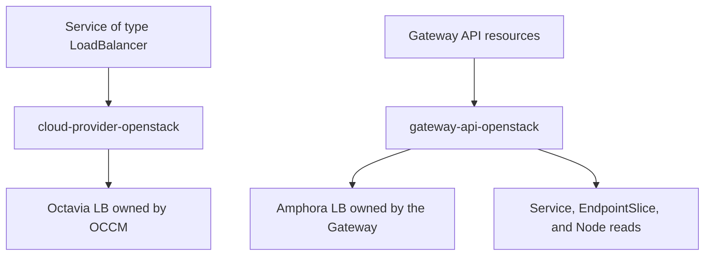

# Gateway API for OpenStack

> [!IMPORTANT]
> This project is pre-alpha and is not ready for production.
> No supported controller environment profile has been published.

This fork ports Gateway API for OpenStack to Kubernetes Gateway API v1.7.0 and adds an opt-in workload addon for clusters created by Magnum and magnum-capi-helm. The first traffic target is a private Amphora VIP forwarding HTTP to a worker NodePort. The [Hibiscus qualification record](docs/qualification/v1.7.0/README.md) covers all seven release profiles, the available evidence and the operator procedure.

The controller uses public OpenStack APIs. It keeps the upstream API group `gateway-api-openstack.github.io` and Go module path. [Personal Hibiscus fork](https://github.com/armeldemarsac92/gateway-api-openstack/tree/hibiscus/v1.7.0) · [Upstream project](https://github.com/gateway-api-openstack/gateway-api-openstack)

## How it works

One Gateway owns one Octavia load balancer and its listeners, pools, members, health monitors, and L7 resources.
The controller reads backend Services, EndpointSlices, and Nodes and manages only its own cloud resources.
The OpenStack Cloud Controller Manager (OCCM) continues to manage Services of type `LoadBalancer` and their cloud resources.

The controller does not adopt existing load balancers, manage tenant network topology, or replace OCCM.
It also does not migrate resources from cloud-provider-openstack's [Octavia Ingress Controller](https://github.com/kubernetes/cloud-provider-openstack/tree/master/docs/octavia-ingress-controller).
The [architecture](docs/design/architecture.md) defines ownership, resource mapping, reconciliation, and recovery.

## Current implementation

The controller uses Gateway API v1.7.0 and defaults to the Standard Channel. Its implemented routing scope includes:

- A Gateway can request one private IPv4 VIP at creation on a class with Floating IP mode `None`. [Configuration and allocation results](docs/qualification/v1.7.0/provider/private-gateway-address.md)
- A plain HTTP Gateway can serve separate backends on several ports of one VIP, including when the requests use the same host and path. Several sections can share one port when each section has a different exact hostname. A port with one section also supports a wildcard or an omitted hostname. Each section enforces its route namespace policy and reports its attachments. [Distinct HTTP ports](docs/qualification/v1.7.0/provider/http-distinct-ports.md) · [Same-port sections](docs/qualification/v1.7.0/provider/http-disjoint-sections.md)
- A platform operator can enable HTTPS with a verified Secret revision in Barbican. An additional regional option lets applications share an HTTPS port using distinct hostnames and the same enrolled certificate. [Set up HTTPS, rotate and revoke](docs/operator-https.md)
- With the Amphora exact-header profile, HTTPRoutes select a backend by a complete request header value and return HTTP 404 when no rule matches. [Enable exact HTTP header matching](docs/operator-octavia-http-header-exact.md)
- An operator can enable HTTP method matching on Amphora. HTTPRoutes can route GET and POST on the same path to different Services and combine methods with exact request headers. [Operator configuration](docs/operator-octavia-http-method-match.md) · [Upstream results](docs/qualification/v1.7.0/provider/http-method-match.md)
- An operator can enable TLS passthrough on Amphora to route exact SNI names on one port to their IPv4 Services. A second opt-in adds wildcard SNI, with exact names and longer suffixes taking precedence. Each TLSRoute can serve several names that match its listener. Each application presents its own certificate. [Enable and use TLS SNI passthrough](docs/operator-octavia-tls-sni-passthrough.md)
- An operator can terminate TLS for a plaintext TCP Service on a dedicated Amphora port using an enrolled certificate. [Enable TLSRoute termination and replay the upstream cases](docs/qualification/v1.7.0/provider/tlsroute-termination.md)
- An HTTPRoute with one managed Gateway reference can serve traffic even when the route also refers to a missing or foreign Gateway. Other controllers keep their own entries in route status. [Parent attachment and evidence](docs/qualification/v1.7.0/provider/http-one-managed-parent.md)
- An HTTPRoute can send different paths to different Service ports. Each rule selects one Service port and can list alternative Exact or PathPrefix matches. The listener ranks the matches across its attached routes. [Configure path routing](docs/getting-started.md#route-several-paths-to-services)
- HTTP/1.1 WebSocket Upgrade to a TCP Service port declaring `appProtocol: kubernetes.io/ws`. [Operator instructions](docs/getting-started.md) · [Qualification](docs/qualification/v1.7.0/provider/http-websocket.md)
- An operator can enable cleartext HTTP/2 to Service ports declaring `appProtocol: kubernetes.io/h2c`. With the fixed-response extension enabled, an HTTP listener can route gRPC by exact service and method. With full-field header matching enabled, it can also select a backend by gRPC metadata. With request header operations enabled, a GRPCRoute can set, add or remove metadata on the selected rule. [Octavia setup](docs/qualification/v1.7.0/provider/octavia-backend-h2c.md) · [GRPCRoute support](docs/qualification/v1.7.0/provider/grpc-h2c-controller.md) · [Metadata routing results](docs/qualification/v1.7.0/provider/grpc-metadata.md)
- Istio ambient can route HTTP and gRPC between Services through a waypoint. Operators enroll selected namespaces and Services. Octavia continues to handle incoming Gateway traffic. [Enable the mesh](integrations/istio-ambient/README.md) · [Local results and remaining consumer-route failure](docs/qualification/v1.7.0/provider/ambient-waypoint.md#extended-results)
- An HTTPRoute can declare several hostnames on one listener when their intersection produces one effective exact name or wildcard. An excluded hostname cannot reach that route’s backend. [Host matching and limits](docs/qualification/v1.7.0/provider/http-host-intersection.md)
- Distinct TCP ports on one dedicated Gateway share its VIP. Each listener selects its oldest eligible TCPRoute. A route that wins on several ports can share one pool. TCPRoute can weight authorized Services across eligible worker NodePorts or routable pod IPs. [TCP example](docs/getting-started.md#forward-tcp-to-a-service) · [Local qualification](docs/qualification/v1.7.0/provider/tcp-upstream.md#multiple-tcp-listeners-on-one-gateway)
- Distinct UDP ports on one dedicated Gateway share its VIP. Each listener selects its oldest eligible UDPRoute. A route that wins on several ports uses one shared pool. Weighted UDP Services distribute traffic across ready pod IPs in Endpoint mode or eligible workers in NodePort mode. [UDP example](docs/getting-started.md#forward-udp-to-a-service)
- Eligible worker NodePort members with Local or Cluster traffic policy
- An opt-in IPv4 Endpoint mode for ClusterIP, headless, and NodePort Services, pending live network validation
- Typed GatewayClass configuration with topology settings fixed for each Gateway
- Automatic allocation for a single `IPAddress` request with no value. Gateway status reports the private VIP or, when the class enables one, the allocated Floating IP. Floating IP recovery also handles detachment.
- Referenced frontend and backend security groups without changing their rules
- Read-only environment diagnostics
- Ownership validation, restart recovery, and ordered cleanup

The [class configuration reference](docs/reference/class-configuration.md) describes member modes and their network prerequisites.
An HTTPRoute, TCPRoute or UDPRoute may select a Service in another namespace when a ReferenceGrant there authorizes that route kind and source namespace. Overlapping plain HTTP sections on one port remain open. [Grant and revocation evidence](docs/qualification/v1.7.0/service-grants.md)
The stock pilot targets Amphora. Other Gateway profiles, the two mesh profiles and the Experimental resources are tracked in the [v1.7.0 feature matrix](docs/qualification/v1.7.0/matrix/README.md).

## Development status

Phase 4 connectivity features are implemented, with live validation and Core design work remaining.
Phase 5 includes the logical HTTP model, shared backend input collection, reference watches, and local Endpoint mode implementation.
See the [compatibility record](docs/providers/compatibility.md) for completed checks and outstanding evidence.
Development results do not establish general OpenStack support or Gateway API conformance.

The [upstream roadmap](ROADMAP.md) targets complete GATEWAY-HTTP Core support and all declared Extended features. The [Hibiscus plan](docs/superpowers/plans/2026-11-20-hibiscus.md) extends the target to the full v1.7.0 release.
The controller and public Octavia extensions are developed and exercised together where a Gateway API feature needs provider support.
The [feasibility assessment](docs/design/conformance-feasibility.md) records the API blockers for individual features.
The [conformance guide](docs/testing-conformance.md) describes the required suite and reporting workflow.

## Getting started

The repository includes Kustomize manifests and a NodePort example for development.
Install the fork’s linux/amd64 development image by digest or build the recorded revision for your registry. The controller reads its OpenStack credentials from a dedicated Secret. [Image record and reproduction](docs/qualification/v1.7.0/image-build.md)
Follow [Getting started](docs/getting-started.md) to install, verify, and remove the controller.
Use the [OpenStack E2E guide](docs/testing-openstack-e2e.md) for reusable traffic, recovery, and cleanup tests.

If finalization stops, keep the controller and its credentials available and follow [operator recovery](docs/operator-recovery.md).
Do not remove finalizers to bypass cleanup.

## Contributing

Start with [CONTRIBUTING.md](CONTRIBUTING.md) for local checks and contribution guidance.
Changes to public APIs, ownership, or recovery contracts follow the [ADR process](docs/design/adr/README.md).
Maintainers preparing artifacts follow the [release procedure](docs/releasing.md).

Project roles are described in [GOVERNANCE.md](GOVERNANCE.md), and the support boundary is in [SUPPORT.md](SUPPORT.md).
GitHub issues and pull requests are the project discussion channels.
This project is independently maintained and is not affiliated with or endorsed by Gateway API, cloud-provider-openstack, or OpenInfra.

## Security

Report vulnerabilities through [SECURITY.md](SECURITY.md), not a public issue.
Participation follows the [code of conduct](code-of-conduct.md).

## License

Licensed under the [Apache License 2.0](LICENSE).
